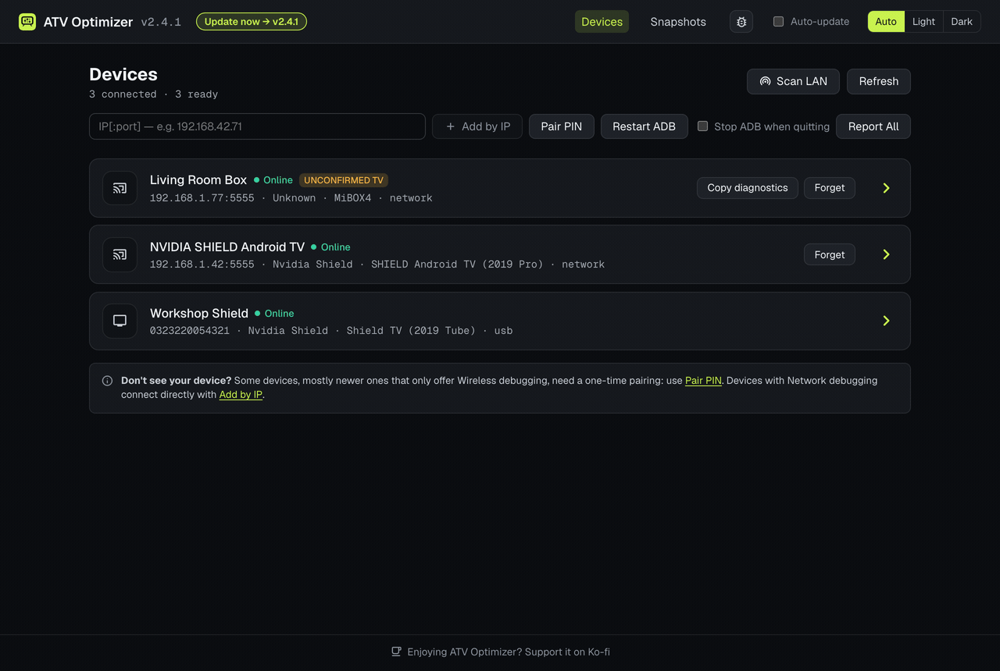
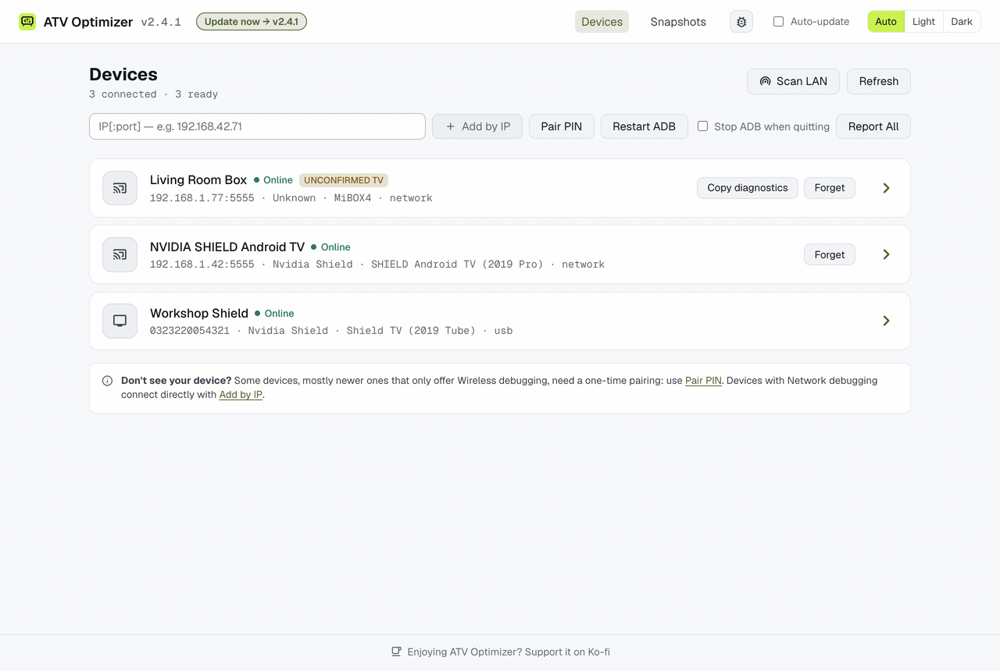

# ATV Optimizer

Debloat and tune your Android TV from your computer. Disable bloat, switch launchers, sideload
APKs, adjust HDMI-CEC and frame-rate matching, and check device health, all from a desktop app.
Works on **Nvidia Shield TV, Onn 4K Pro, Chromecast with Google TV, Google TV Streamer** and other
Android TV devices.



<details>
<summary>Light theme</summary>



</details>

It's a native app for macOS, Windows and Linux. It downloads its own `adb` on first launch, finds
TVs on your network, and updates itself. You don't need a terminal or any scripting.

> **📱 Coming soon: [ATV Optimizer for Android](#atv-optimizer-for-android).** A phone and tablet
> version that runs the same cleanup over Wi-Fi, with no computer involved. It's in testing now.

## Install

### macOS: Homebrew (easiest)

```sh
brew tap bryanroscoe/shield-optimizer
brew install --cask shield-optimizer
```

Homebrew clears the macOS quarantine flag for you, so the app opens with a normal double-click.
Upgrade with `brew upgrade --cask shield-optimizer`, or let the app update itself.

### Any platform: download an installer

Get an installer from the [**Releases page**](https://github.com/bryanroscoe/shield_optimizer/releases).
Choose the newest stable `v2-*` desktop release; `v0.*` releases contain the legacy PowerShell script:

| OS | File |
|----|------|
| Windows | `.msi` or `_x64-setup.exe` |
| macOS | `_universal.dmg` (Apple Silicon + Intel) |
| Linux | `.AppImage`, `.deb`, or `.rpm` |

### First launch

The builds aren't code-signed yet, so your OS may warn you the first time you open the app. You
only have to dismiss it once:

- **macOS** (`.dmg` only, Homebrew skips this): on macOS 15+ the dialog only offers *Move to
  Trash* / *Done*. Click **Done**, then either go to System Settings → Privacy & Security →
  **Open Anyway**, or run `xattr -dr com.apple.quarantine "/Applications/ATV Optimizer.app"`.
- **Windows** (SmartScreen): **More info → Run anyway**.
- **Linux**: `chmod +x ATV.Optimizer*.AppImage` before running the AppImage.

## Before you start

Turn on ADB on the TV. You only do this once:

1. **Settings → Device Preferences → About →** select **Build** 7 times to unlock Developer Options.
2. **Settings → Developer Options →** turn on **Network debugging**, or **Wireless debugging** if
   that's what your TV offers. Many Google TV devices only have Wireless debugging.

The first time the app connects, the TV asks **"Allow debugging?"**. Accept it.

## Using it

1. Launch the app. It scans your network and lists the Android TV devices it finds.
2. Accept the debugging prompt on the TV if one appears.
3. Click your device. Each tab is a feature:

| Tab | What it does |
|-----|--------------|
| **Overview** | Model, Android version, build and hardware ID. |
| **Health** | Temperature, CPU and network sampling, RAM and storage, display mode and HDR, audio, and the apps using the most memory, each with a safety verdict. |
| **Playback** | What the TV is actually outputting: resolution, refresh rate, HDR and audio passthrough. |
| **Launcher** | Install a supported launcher, make it the default, and, where the firmware allows it, disable the stock launcher after you confirm. |
| **App List** | Disable, enable or uninstall any app, or install one from the Play Store. |
| **Optimize** | The debloat wizard. Review each app's recommended action and RAM use, untick anything you want to keep, then **Run**. Undo it later with Restore. |
| **Tweaks** | HDMI-CEC, match-content frame rate, long-press timeout, animation speed, display scaling, audio passthrough, Private DNS. |
| **Remote** | An on-screen D-pad and live typing over a low-latency channel. Paste a long URL or password instead of typing it on the TV. |
| **Files** | Browse `/sdcard`, copy files to and from your computer, and find an app's exported backups. |
| **Install APK** | Sideload an `.apk` from a folder. |
| **Snapshot** | Save a device's state and re-apply it later, to the same device (rollback) or a different one (clone). |
| **Shell** | Run an ADB shell command directly, for anything the UI doesn't cover. |

### Can't find your TV?

Use **Scan Network**, **Connect IP** or **Pair PIN**.

**Scan Network** looks two ways. It sweeps your subnet on ADB's standard port (5555), which older
devices like the Shield use. It also checks the devices ADB has discovered over mDNS. That second
check matters on Android 11+, where Wireless debugging listens on a random port that changes every
time you toggle it, so a port sweep can't find it. If a TV is only advertising its pairing service,
the scan tells you and fills in the pairing address for you.

**Pair PIN** is for Android 11+ Wireless debugging. On the TV, open **Pair device with pairing
code** and enter the IP:port and code it shows. Pairing makes the TV trust your computer but doesn't
connect to it. Go back to the main Wireless debugging screen and enter the IP:port shown *there* in
**Connect IP**. It's a different port from the pairing one. If ADB connects the paired TV on its
own, it shows up when the device list refreshes.

## Safety

- **Disable, don't uninstall.** Disabled apps can usually be re-enabled, but firmware permissions
  may prevent it. Uninstalling can remove data that Restore can't bring back.
- A curated **do-not-disable list** blocks disables that would break the device, in every curated
  action: Optimize, App List, the Launcher wizard and Snapshot apply.
- **Recovery** asks the TV to re-enable every disabled package and reports any it refused.
- The **Shell** tab is the exception: it runs whatever you type. Its warnings are there for a
  reason. A bad command can erase data or leave the device unusable.

**Use at your own risk.** Changing system apps always carries some risk, but the app favors safe,
reversible changes.

## Tested devices

| Device | Status |
|--------|--------|
| Nvidia Shield TV (2015/2017/2019) | Fully tested |
| Onn 4K Pro (Walmart) | Fully tested |
| Chromecast with Google TV | Should work (Google TV profile) |
| Google TV Streamer (2024) | Should work (Google TV profile) |
| Amazon Fire TV | Varies by Fire OS build (see [Known limitations](#known-limitations)) |

What's available depends on each device's firmware and the permissions it grants ADB. Android
version alone doesn't decide it. Discovery and pairing need the firmware to expose a working ADB
service, authorize the connection, and be reachable on your network.

## Known limitations

**Fire TV launcher changes depend on the build.** Some Fire OS builds refuse changes to Amazon's
protected stock launcher, including attempts to re-enable it. The app recognizing Projectivy or
another supported launcher doesn't mean the firmware will let you change Home or disable stock.
When a change fails, the app reports three things separately: the command error, whether its
precautionary restore worked, and which Home app the TV actually reports. It doesn't try to get
around firmware protection. [Issue #205](https://github.com/bryanroscoe/shield_optimizer/issues/205)
tracks a Toshiba Fire TV report that's still waiting on version and build details.

**Unsigned builds.** See [First launch](#first-launch) above.

**Renamed from Shield Optimizer.** It's the same app with the same settings and update channel.
The Homebrew tap and cask are still called `shield-optimizer`, so `brew upgrade` keeps working. If
you installed from the `.dmg`, you'll still have the old `Shield Optimizer.app` until you
reinstall. After that you can drag the old one to the Trash.

## ATV Optimizer for Android

**Coming soon.** A phone and tablet version that drives your TV over Wi-Fi with no computer
involved: the same app list, safety checks, launcher switching and tweaks as the desktop app. It's
in testing now and hasn't been released.
[Watch the repo](https://github.com/bryanroscoe/shield_optimizer) to hear when it ships.


The walkthrough shows demo data, not a live device. Developer notes are in [`v2/mobile/`](v2/mobile/README.md).

## Legacy: PowerShell script (v1)

This project started as a PowerShell script, `Shield-Optimizer.ps1`. It's now **legacy**: it still
works and still gets fixes for serious bugs, but new features only go into the desktop app. If you
need a terminal tool for scripting, a headless box or Docker, see
**[docs/LEGACY-V1.md](docs/LEGACY-V1.md)** for setup and usage.

## Contributing

Building from source, architecture and release process: [`v2/README.md`](v2/README.md).

## Credits

- Debloat research from community guides including [florisse.nl/shield-debloat](https://florisse.nl/shield-debloat/)
- Built with AI assistance (Gemini Pro and Claude) by an actual software engineer, tested on real devices
