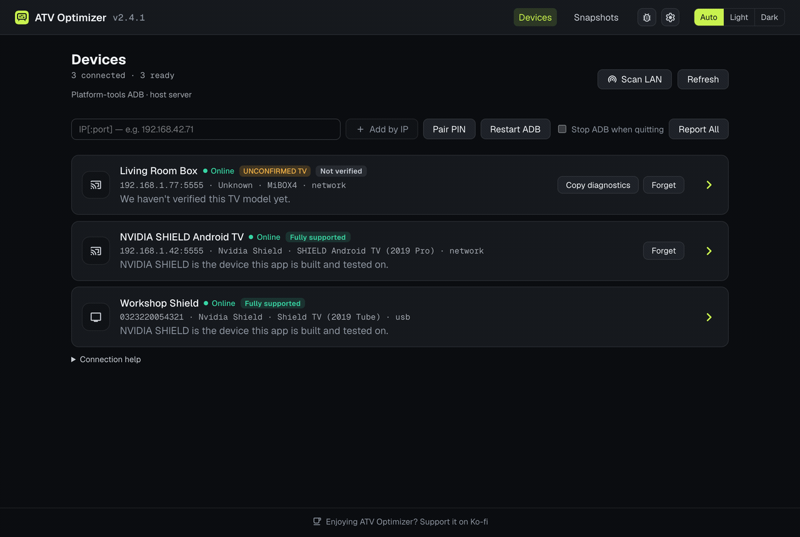
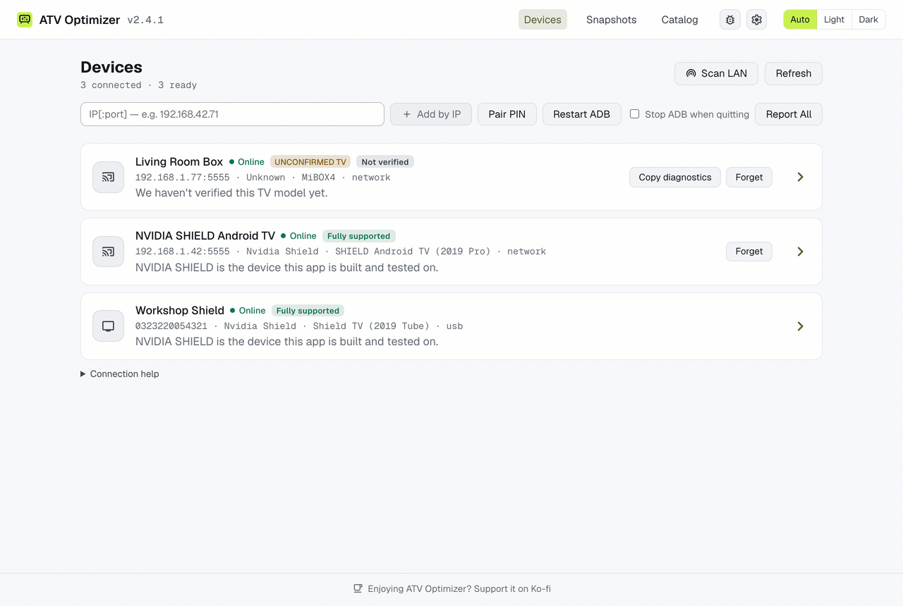
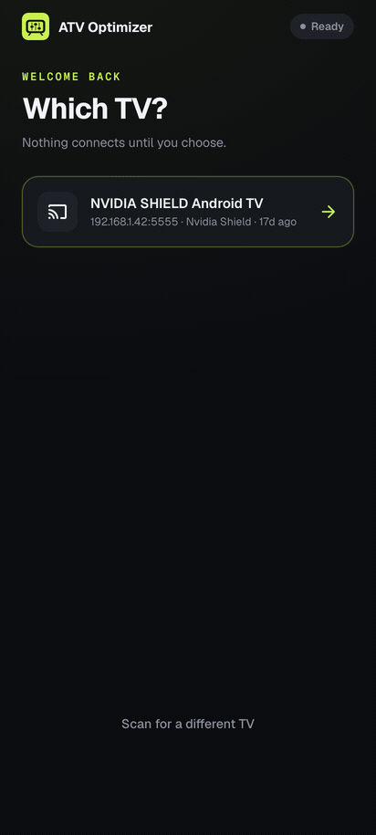

# ATV Optimizer

Debloat and tune your Android TV from your computer. Disable bloat, switch launchers, sideload
APKs, adjust HDMI-CEC and frame-rate matching, and check device health, all from a desktop app.
Works on **Nvidia Shield TV, Onn 4K Pro, Chromecast with Google TV, Google TV Streamer** and other
Android TV devices.

> **Known ADB issue in 2.4.1:** A SHIELD TV Pro on macOS has been reported missing from Scan LAN
> or going offline until connected with standalone ADB. [Workaround and status](#known-limitations).



<details>
<summary>Light theme</summary>



</details>

It's a native app for macOS, Windows and Linux. It connects to your TVs directly with its own
built-in ADB, finds them on your network, and updates itself. You don't need a terminal, Google's
`adb` or any scripting. Google's platform-tools are still one click away in **Settings → ADB** if a
TV doesn't get along with the built-in engine, or for a TV connected by USB.

> **📱 Coming soon: [ATV Optimizer for Android](#atv-optimizer-for-android).** A phone and tablet
> version that runs the same cleanup over Wi-Fi, with no computer involved. It's in testing now.

## Install

### macOS: Homebrew (easiest)

```sh
brew tap bryanroscoe/shield-optimizer
brew install --cask atv-optimizer
```

Homebrew clears the macOS quarantine flag for you, so the app opens with a normal double-click.
Upgrade with `brew upgrade --cask atv-optimizer`, or let the app update itself.

### Any platform: download an installer

Get an installer from the [**Releases page**](https://github.com/bryanroscoe/shield_optimizer/releases).
Choose the newest stable `v2-*` desktop release; `v0.*` releases contain the legacy PowerShell script:

| OS | File |
|----|------|
| Windows | `.msi` or `_x64-setup.exe` |
| macOS | `_universal.dmg` (Apple Silicon + Intel) |
| Linux | `.AppImage`, `.deb`, `.rpm`, or `_x86_64.flatpak` |

### First launch

The builds aren't code-signed yet, so your OS may warn you the first time you open the app. You
only have to dismiss it once:

- **macOS** (`.dmg` only, Homebrew skips this): on macOS 15+ the dialog only offers *Move to
  Trash* / *Done*. Click **Done**, then either go to System Settings → Privacy & Security →
  **Open Anyway**, or run `xattr -dr com.apple.quarantine "/Applications/ATV Optimizer.app"`.
- **Windows** (SmartScreen): **More info → Run anyway**.
- **Linux**: `chmod +x ATV.Optimizer*.AppImage` before running the AppImage.
  The Flatpak installs with `flatpak install --user ATV.Optimizer_*_x86_64.flatpak`. It doesn't
  update itself: install the next release's `.flatpak` the same way.

On macOS 15+, also click **Allow** when macOS asks whether ATV Optimizer can find devices on your
local network. Without it, the app can't reach any TV.

## Before you start

Turn on ADB on the TV. You only do this once:

1. **Settings → Device Preferences → About →** select **Build** 7 times to unlock Developer Options.
2. **Settings → Developer Options →** turn on **Network debugging**, or **Wireless debugging** if
   that's what your TV offers. Many Google TV devices only have Wireless debugging.

The TV has to allow this computer once. A TV that hasn't yet is listed as **Not allowed yet**:
click **Request approval**, then on the TV tick **Always allow from this computer** and choose
**Allow**.

## Using it

1. Launch the app. It scans your network and lists the Android TV devices it finds.
2. For a TV marked **Not allowed yet**, click **Request approval** and choose **Allow** on the TV.
3. Click your device. Each tab is a feature:

| Tab | What it does |
|-----|--------------|
| **Overview** | Model, Android version, build and hardware ID. |
| **Health** | Temperature, CPU and network sampling, RAM and storage, display mode and HDR, audio, and the apps using the most memory, each with a safety verdict. |
| **Playback** | What the TV is actually outputting: resolution, refresh rate, HDR and audio passthrough. |
| **Launcher** | Install a supported launcher, make it the default, and, where the firmware allows it, disable the stock launcher after you confirm. |
| **App List** | Disable, enable or uninstall any app, or install one from the Play Store. |
| **Optimize** | The debloat wizard. Review each app's recommended action and RAM use, untick anything you want to keep, then **Run**. Undo it later with Restore. |
| **Tweaks** | HDMI-CEC, match-content frame rate, long-press timeout, animation speed, display scaling, audio passthrough, Private DNS. |
| **Remote** | An on-screen D-pad and live typing over a low-latency channel. Paste a long URL or password instead of typing it on the TV. |
| **Files** | Browse `/sdcard`, copy files to and from your computer, and find an app's exported backups. |
| **Install APK** | Sideload an `.apk` from a folder. |
| **Snapshot** | Save a device's state and re-apply it later, to the same device (rollback) or a different one (clone). |
| **Shell** | Run an ADB shell command directly, for anything the UI doesn't cover. |

### Can't find your TV?

Use **Scan LAN**, **Add by IP** or **Pair PIN**.

**A TV that has never allowed this computer** is listed as **Not allowed yet**. Scanning never
shows anything on the TV. Click **Request approval** on its row: the TV asks "Allow debugging?"
(some say "Allow USB debugging?"). Tick **Always allow from this computer** and choose Allow. The
app waits up to 10 minutes; **Cancel** stops waiting. TVs that already allow Google's `adb` on this
computer connect without asking. With Google platform-tools chosen in Settings, the TV asks by
itself the first time the app connects instead.

**On a Mac, if nothing is found even by IP,** macOS may be blocking the app: open System Settings →
Privacy & Security → **Local Network** and turn ATV Optimizer on. If it already looks on, turn it
off and on again. If it's listed more than once, turn every entry on. Then scan again.

With **Google platform-tools** chosen in Settings, click **Restart ADB** first instead: after an
update, macOS cuts off the ADB server the previous version left running. The app restarts it by
itself when it notices, and a manual restart does the same.

**Scan LAN** looks two ways. It sweeps your subnet on ADB's standard port (5555), which older
devices like the Shield use. It also listens for TVs that announce themselves over mDNS. That second
check matters on Android 11+, where Wireless debugging listens on a random port that changes every
time you toggle it, so a port sweep can't find it. If a TV is only advertising its pairing service,
the scan tells you and fills in the pairing address for you.

**Pair PIN** is for Android 11+ Wireless debugging. On the TV, open **Pair device with pairing
code** and enter the IP:port and code it shows. Pairing makes the TV trust your computer but doesn't
connect to it. Go back to the main Wireless debugging screen and enter the IP:port shown *there* in
**Add by IP**. It's a different port from the pairing one. If ADB connects the paired TV on its
own, it shows up when the device list refreshes.

## Safety

- **Disable, don't uninstall.** Disabled apps can usually be re-enabled, but firmware permissions
  may prevent it. Uninstalling can remove data that Restore can't bring back.
- A curated **do-not-disable list** blocks disables that would break the device, in every curated
  action: Optimize, App List, the Launcher wizard and Snapshot apply.
- **Recovery** asks the TV to re-enable every disabled package and reports any it refused.
- The **Shell** tab is the exception: it runs whatever you type. Its warnings are there for a
  reason. A bad command can erase data or leave the device unusable.

**Use at your own risk.** Changing system apps always carries some risk, but the app favors safe,
reversible changes.

## Tested devices

| Device | Status |
|--------|--------|
| Nvidia Shield TV (2015/2017/2019) | Fully tested |
| Onn 4K Pro (Walmart) | Fully tested |
| Chromecast with Google TV | Should work (Google TV profile) |
| Google TV Streamer (2024) | Should work (Google TV profile) |
| TCL Google TV | Beta: limited testing so far |
| Amazon Fire TV | Not supported: Fire OS blocks the changes this app makes (see [Known limitations](#known-limitations)) |

What's available depends on each device's firmware and the permissions it grants ADB. Android
version alone doesn't decide it. Discovery and pairing need the firmware to expose a working ADB
service, authorize the connection, and be reachable on your network.

The app shows each connected TV's support status next to its name: **Fully supported**,
**Supported**, **Beta**, **Not supported**, or **Not verified** for a model nobody has checked yet.
The status is information only. It never loosens the do-not-disable list, and on an unsupported TV
the app warns before making changes but still lets you re-enable apps and run Recovery.

## Privacy

The app sends **anonymous device and error reports** by default, so we can learn which TVs it runs
on and where it fails. A report has your TV's make, model and Android version, the app version and
your computer's or phone's OS, which actions worked or failed, and error messages with addresses,
names and file paths removed. It never includes serial numbers or other hardware IDs, IP addresses,
TV names, your list of installed apps, file paths, license details or snapshot contents. Reports go
to a server we run on Cloudflare and are kept for 90 days. The server doesn't record where a
report came from: no IP address and no location, not even your country.

Turn this off with **Share anonymous device and error reports**, in the **Report a bug** dialog on
desktop or on the **More** screen on Android. Turning it off stops sending immediately and discards anything not yet sent; turning it
back on starts over under a new random ID. Builds made without a report server configured send
nothing.

## Known limitations

**ADB discovery and reconnection.**

[Issue #235](https://github.com/bryanroscoe/shield_optimizer/issues/235) reports a SHIELD TV Pro on macOS running
2.4.1 being missed by **Scan LAN**, or later appearing **OFFLINE**, until connected with standalone
ADB and refreshed in the app. The full cause is still under investigation.

If this happens, try **Add by IP** with the TV's current address, approve any debugging prompt on
the TV, then **Refresh**. The reporter has not confirmed whether Add by IP avoids this failure;
the recovery they verified used standalone ADB. **Restart ADB** disconnects other tools using the
same server, and did not recover the reporter's connection in 2.4.1.

Connection-recovery improvements are merged for the next desktop release and await physical
confirmation of this report. They are not included in 2.4.1.

**Built-in ADB is network-only.** A TV connected by USB needs **Google platform-tools**, chosen in
**Settings → ADB → ADB engine**. Switching takes effect immediately, and you can switch back.

**Fire TV launcher changes depend on the build.** Some Fire OS builds refuse changes to Amazon's
protected stock launcher, including attempts to re-enable it. The app recognizing Projectivy or
another supported launcher doesn't mean the firmware will let you change Home or disable stock.
When a change fails, the app reports three things separately: the command error, whether its
precautionary restore worked, and which Home app the TV actually reports. It doesn't try to get
around firmware protection. [Issue #205](https://github.com/bryanroscoe/shield_optimizer/issues/205)
tracks a Toshiba Fire TV report that's still waiting on version and build details.

**Unsigned builds.** See [First launch](#first-launch) above.

**Renamed from Shield Optimizer.** It's the same app with the same update channel. From 2.5.0 it
also uses the new name for its data folder and app identifier: the first launch copies your
settings, snapshots and logs over and leaves the old copies in place. On Windows, the 2.5.0
`-setup.exe` installer (and an in-app update of a setup install) removes a leftover "Shield
Optimizer" install; the `.msi` doesn't, so remove that one from Add/Remove Programs yourself. On
macOS, a `Shield Optimizer.app` renames itself to `ATV Optimizer.app` when you quit it. If you
have both `Shield Optimizer.app` and `ATV Optimizer.app` (for example from installing a DMG beside
an older copy), drag `Shield Optimizer.app` to the Trash. The Homebrew cask is now
`atv-optimizer`; `shield-optimizer` keeps working and `brew upgrade` moves you over.

## ATV Optimizer for Android

**Coming soon.** A phone and tablet version that drives your TV over Wi-Fi with no computer
involved: the same app list, safety checks, launcher switching and tweaks as the desktop app. It's
in testing now and hasn't been released.
[Watch the repo](https://github.com/bryanroscoe/shield_optimizer) to hear when it ships.



The walkthrough shows demo data, not a live device. Developer notes are in [`v2/mobile/`](v2/mobile/README.md).

## Legacy: PowerShell script (v1)

This project started as a PowerShell script, `Shield-Optimizer.ps1`. It's now **legacy**: it still
works and still gets fixes for serious bugs, but new features only go into the desktop app. If you
need a terminal tool for scripting, a headless box or Docker, see
**[docs/LEGACY-V1.md](docs/LEGACY-V1.md)** for setup and usage.

## Contributing

Building from source, architecture and release process: [`v2/README.md`](v2/README.md).

## Credits

- Debloat research from community guides including [florisse.nl/shield-debloat](https://florisse.nl/shield-debloat/)
- Built with AI assistance (Gemini Pro and Claude) by an actual software engineer, tested on real devices
