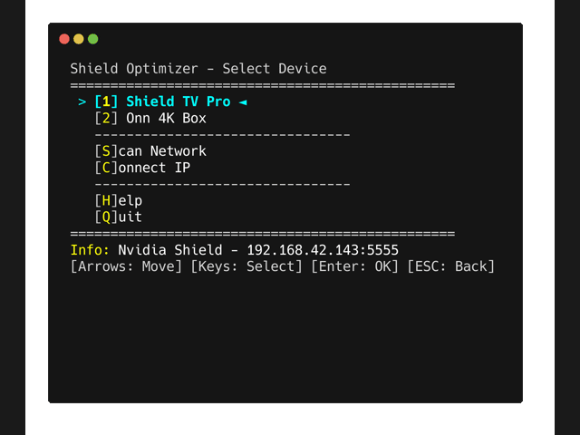

# v1 — PowerShell script (legacy)

> **v1 is legacy.** The [ATV Optimizer desktop app](../README.md) is the official version and the
> one getting new features. v1 still works and still gets fixes for serious bugs, but it won't get
> new features. If you're new, use the desktop app.
>
> Stay on v1 only if you specifically need a terminal tool: scripting, a headless box, or Docker.



The original cross-platform PowerShell tool with a text UI that runs in your terminal. It needs
**PowerShell 7+** and runs on Windows, macOS and Linux.

Set up ADB on the TV first. The steps are the same as for the desktop app; see
[Before you start](../README.md#before-you-start).

## Install PowerShell 7 and get the script

<details>
<summary><b>Windows</b></summary>

PowerShell 7 is required; Windows Terminal is recommended.

**winget (recommended)**
```powershell
winget install --id Microsoft.PowerShell; winget install --id Microsoft.WindowsTerminal
```

**Or download installers**
- PowerShell 7: [GitHub releases](https://github.com/PowerShell/PowerShell/releases/latest) — get the `.msi`
- Windows Terminal: [Microsoft Store](https://aka.ms/terminal)

Then open Windows Terminal → PowerShell 7 and run `pwsh .\Shield-Optimizer.ps1`.
</details>

<details>
<summary><b>macOS</b></summary>

```bash
# Install Homebrew if you don't have it
/bin/bash -c "$(curl -fsSL https://raw.githubusercontent.com/Homebrew/install/HEAD/install.sh)"

# Install PowerShell
brew install powershell
```

Alternative: the `.pkg` installer from [PowerShell releases](https://github.com/PowerShell/PowerShell/releases/latest).
</details>

<details>
<summary><b>Linux (Debian/Ubuntu)</b></summary>

```bash
sudo apt-get update
sudo apt-get install -y wget apt-transport-https software-properties-common
wget -q "https://packages.microsoft.com/config/ubuntu/$(lsb_release -rs)/packages-microsoft-prod.deb"
sudo dpkg -i packages-microsoft-prod.deb
sudo apt-get update
sudo apt-get install -y powershell

pwsh ./Shield-Optimizer.ps1
```
</details>

<details>
<summary><b>Linux (Docker)</b></summary>

> *Should work, but not verified end-to-end.* Based on the workflow @shawly reported in [#9](https://github.com/bryanroscoe/shield_optimizer/issues/9).

`--network host` is required so the script can scan your LAN; `iproute2` is needed inside the container for auto-discovery.

```bash
docker run -it --rm --network host mcr.microsoft.com/powershell:latest

# Inside the container:
apt-get update && apt-get install -y iproute2
Invoke-WebRequest -Uri https://github.com/bryanroscoe/shield_optimizer/raw/refs/heads/main/Shield-Optimizer.ps1 -OutFile Shield-Optimizer.ps1
./Shield-Optimizer.ps1
```

> **Note:** `--network host` only works on native Linux. On Docker Desktop for macOS/Windows, auto-discovery won't see your LAN — install PowerShell natively or use **Connect IP**.
</details>

**Get the script:** download `Shield-Optimizer.ps1` from the
[repository](https://github.com/bryanroscoe/shield_optimizer/blob/main/Shield-Optimizer.ps1), or
`git clone https://github.com/bryanroscoe/shield_optimizer.git`. Run it from the folder it lives in.

## Run it

```powershell
pwsh ./Shield-Optimizer.ps1
```

ADB tools download automatically on first run. A few flags:

```powershell
pwsh ./Shield-Optimizer.ps1 -ForceAdbDownload   # re-download ADB tools
pwsh ./Shield-Optimizer.ps1 -LightMode          # force light theme
pwsh ./Shield-Optimizer.ps1 -DarkMode           # force dark theme
```

(Theme auto-detects your system setting; the flags only override it.)

### Keyboard shortcuts

| Key | Action |
|-----|--------|
| `↑` `↓` | Navigate menu |
| `←` `→` | Toggle options (YES/NO) |
| `1-9` | Select device by number |
| `A-Z` | Select option by highlighted letter |
| `Enter` | Confirm |
| `ESC` | Back / Cancel / Abort |

## Troubleshooting

**Windows — "Running scripts is disabled on this system"**

PowerShell blocks unsigned scripts by default. Either set the execution policy once (PowerShell 7 as Administrator):
```powershell
Set-ExecutionPolicy -ExecutionPolicy RemoteSigned -Scope CurrentUser
```
or bypass for a single run: `pwsh -ExecutionPolicy Bypass -File .\Shield-Optimizer.ps1`.

**Windows — script errors or won't run**

Make sure you're on **PowerShell 7**, not Windows PowerShell 5.x (blue icon). Check with `$PSVersionTable.PSVersion` — major version should be 7+. Launch it from Windows Terminal's dropdown → "PowerShell" (not "Windows PowerShell").

**Other issues**

| Problem | Solution |
|---------|----------|
| Device not found | Enable Network Debugging, try Scan Network, check TV for auth prompt |
| Device shows UNAUTHORIZED | Accept the "Allow USB debugging?" prompt on your TV |
| Launcher won't switch | Review the Launcher Wizard diagnostics and actual Home readback. Some firmware rejects changing its protected stock launcher; retrying takeover does not remove that restriction. |
| Something broke | Recovery can request re-enabling disabled packages; check reported failures because firmware may refuse changes. |
| Wrong device type | Check Profile view; detection uses brand/model/packages |
| Scan finds nothing (macOS/Linux) | Ensure Network Debugging is on; try Connect IP |
| Colors hard to read | Try `-LightMode` or `-DarkMode` |

## Experimental (untested on real devices)

| Feature | Notes |
|---------|-------|
| **USB device support** | `[USB]` tag in the device list. Shield TV doesn't support USB debugging (host ports only); works with phones/tablets. |
| **PIN pairing** | For Android 11+ / Google TV devices that require pairing codes. Not needed for Shield (use Connect IP). |

## Feature catalog

[`FEATURES.md`](FEATURES.md) documents v1's behavior in detail: bloat lists, ADB commands and
edge cases. It covers v1 only.
