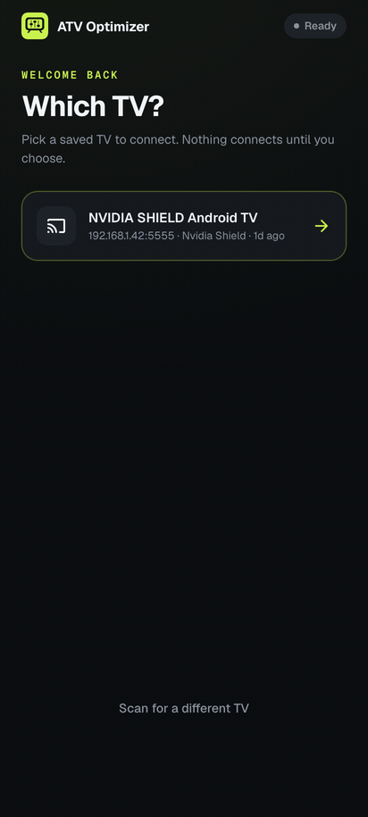
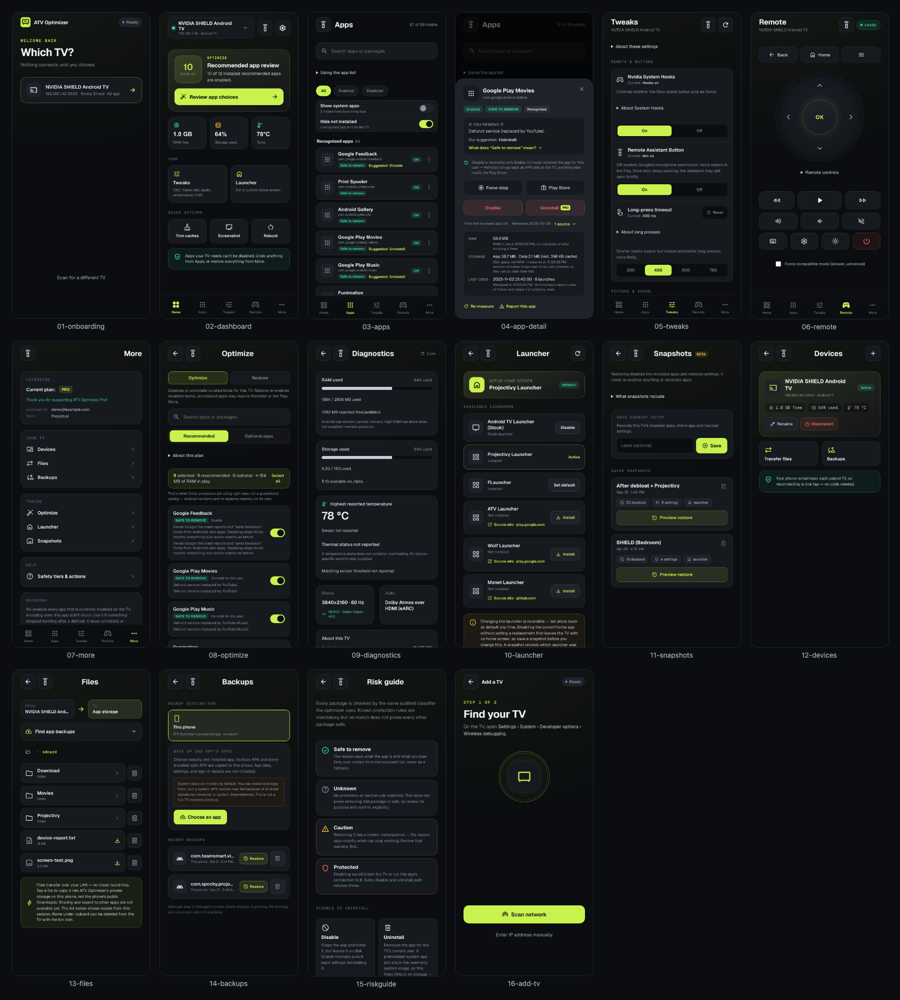

# ATV Optimizer (mobile)

An Android phone/tablet app that drives an Android TV over **wireless ADB** — no PC in the loop.
Tauri 2 + Rust + Svelte 5, sharing the audited engine (`v2/crates/core`) with the desktop app.



<details>
<summary>Every screen at once</summary>



</details>

> Screenshots show demo data, not a live device. Regenerate with `npm run screenshots` from this
> directory (needs `ffmpeg` and `npx playwright install chromium`); see
> [`screenshots/capture.mjs`](screenshots/capture.mjs).

**[`HANDOFF.md`](HANDOFF.md) is the authoritative document.** Read it before doing any work here;
this file is only an orientation. [`BACKLOG.md`](BACKLOG.md) is the ordered queue.

## How it talks to the TV

- **Transport is the vendored pure-Rust `adb_client`** (`v2/vendor/adb_client`, MIT), wrapped by
  `WirelessAdb` in `src-tauri/src/wireless_adb.rs`, which implements the shared `AdbDriver` trait.
  Shell, push/pull, screencap and pairing all run through it.
- **The Kotlin plugin (`tauri-plugin-atv-adb/`) is mDNS discovery only** — Android's `NsdManager`,
  no third-party native libraries.
- The transport carries no GPL code, because the app is sold as a closed-source product.
  [`HANDOFF.md`](HANDOFF.md) §2 explains what that rules out.
- **Legacy network debugging (`:5555`, no code) is the proven path.** Android 11+ code pairing
  (SPAKE2) is implemented in the vendored crate but is **not yet verified against a real adbd** —
  see [`PAIRING-PLAN.md`](PAIRING-PLAN.md).

## Layout

- `src/` — Svelte 5 frontend: 14 screens in `screens/`, shared components in `components/`, and
  the typed API / session / router / saved-device logic in `lib/`.
- `src-tauri/src/` — `lib.rs` (command registration), `wireless_adb.rs` (the transport),
  `wireless_commands.rs`, `file_commands.rs`.
- `tauri-plugin-atv-adb/` — the mDNS discovery plugin.

## Gates

```
npm run check     # svelte-check, must be 0 errors / 0 warnings
npm run build
npm test          # browser suite: real Svelte screens, Tauri invokes stubbed
```

CI runs all three on every pull request and every push to `main` that touches `v2/`
(`.github/workflows/v2-tests.yml`, `frontend-mobile` job).

## What is still unproven

Nothing in `v2/mobile` has been verified on a phone or TV in its current form. The browser suite
exercises the real screens against a mocked Tauri layer, which is worth a lot but is not a device.
The open physical gates are listed in [`BACKLOG.md`](BACKLOG.md); the largest are code pairing
against a real adbd, the fast-remote device matrix ([`FAST-REMOTE-PLAN.md`](FAST-REMOTE-PLAN.md)),
and the app-restart report ([`LIFECYCLE-EVIDENCE.md`](LIFECYCLE-EVIDENCE.md)).

Release and signing: [`RELEASE.md`](RELEASE.md). Licensing: [`LICENSING.md`](LICENSING.md).
